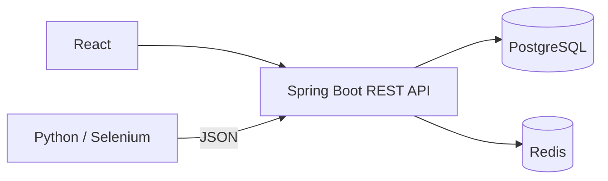

# Offer Browser Prototype

**Przeglądarka ofert pracy IT z listą obserwowanych ogłoszeń, historią aplikacji i analizą wymaganych umiejętności.**

Aplikacja webowa zbiera ogłoszenia z No Fluff Jobs. Pozwala porównać wymagania, wynagrodzenia i poziomy doświadczenia oraz zapisać, na które stanowiska wysłano już CV.

**Java 17 · Spring Boot 3.2.5 · React 19 · PostgreSQL · Redis · Python**

[Możliwości](#możliwości) · [Architektura](#architektura) · [Uruchomienie lokalne](#uruchomienie-lokalne) · [Testy](#testy)

## Możliwości

| Obszar | Co można zrobić |
| --- | --- |
| **Oferty pracy** | Przeglądać ogłoszenia i sprawdzać firmę, lokalizację, widełki wynagrodzenia, poziom doświadczenia oraz wymagane i dodatkowe umiejętności. |
| **Moje oferty** | Obserwować interesujące ogłoszenia, odnotować wysłanie aplikacji, ukrywać nieprzydatne oferty i dodawać notatki. |
| **Analityka** | Sprawdzać najczęściej występujące umiejętności według poziomu doświadczenia oraz rozkład ofert według miast i poziomów. |
| **Import** | Pobrać oferty skryptem Python z Selenium, zaimportować dane z JSON lub dodać pojedyncze ogłoszenie z linku. |
| **Powiadomienia** | Otrzymywać zestawienie e-mail i z jego poziomu zapisać status aplikacji lub ukryć ofertę. |

Aplikacja obsługuje rejestrację z potwierdzeniem e-mail i logowanie JWT. Panel administracyjny pokazuje aktywność użytkowników oraz zgłoszone duplikaty i nieprzydatne oferty.

## Architektura



- **Logika biznesowa.** Kontrolery REST delegują operacje do fasad, które składają handlery odpowiedzialne m.in. za import, statusy aplikacji i statystyki.
- **Analityka.** Wymagania ofert mają własne encje. Zapytania agregujące zwracają wyniki potrzebne do wykresów bez wczytywania pełnych ogłoszeń.
- **Dane i interfejs.** PostgreSQL przechowuje oferty, konta i statusy użytkowników. Redis przechowuje w cache dane ofert, a React wyświetla statystyki za pomocą Recharts.

| Kod | Zawartość |
| --- | --- |
| [Backend](src/main/java/com/example/offerbrowserprototype) | Domena, REST API, Spring Security, repozytoria i cache |
| [Frontend](frontend/src) | Widoki React, routing, obsługa stanu w Zustand i klient API |
| [Skrypty importu](src/main/resources/scripts) | Pobieranie ofert i mapowanie danych do JSON |
| [Testy backendu](src/test/java) | Testy jednostkowe logiki i integracyjne repozytoriów |

## Uruchomienie lokalne

Wymagania obejmują **JDK 17**, **Node.js 22.12+**, **npm** i **Docker Compose**. Do importu bezpośrednio z portalu potrzebne są również Python, Selenium i Chrome.

**1. Baza danych i cache** — z katalogu głównego projektu.

```sh
docker compose up -d postgres redis
```

**2. Backend** — z katalogu głównego projektu.

```powershell
.\mvnw.cmd spring-boot:run
```

Na macOS i Linuksie użyj `./mvnw spring-boot:run`. API nasłuchuje pod adresem `http://localhost:8081`, a Swagger UI jest dostępny pod `http://localhost:8081/swagger-ui.html`.

**3. Frontend** — w osobnym terminalu.

```sh
cd frontend
npm ci
npm run dev
```

Otwórz `http://localhost:3000`. Rejestracja z potwierdzeniem i powiadomienia korzystają z SMTP. Przykładowe dane do importu są w pliku [detailed_offers.json](data/offers/detailed_offers.json).

## Testy

Backend zawiera testy jednostkowe z JUnit i Mockito oraz testy integracyjne repozytoriów z H2. Uruchom je z katalogu głównego projektu.

```powershell
.\mvnw.cmd test
```

Na macOS i Linuksie użyj `./mvnw test`.
