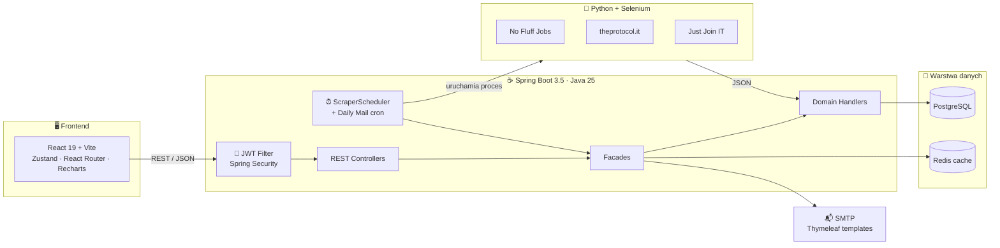
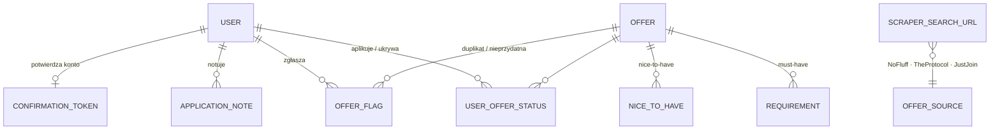

<div align="center">

# 🔎 Offer Browser

### Agregator ofert pracy IT z trzech portali w jednym miejscu: śledzenie aplikacji i analityka rynku

**Codziennie automatycznie pobiera oferty z No Fluff Jobs, theprotocol.it i Just Join IT. Pokazuje, których umiejętności rynek naprawdę szuka, i pozwala zapisywać, gdzie wysłano już CV.**

<br/>


<br/>


<br/>

[✨ Możliwości](#-możliwości) •
[🏗️ Architektura](#️-architektura) •
[🧠 Ciekawe rozwiązania](#-ciekawe-rozwiązania-techniczne) •
[📡 REST API](#-rest-api--pełna-lista-endpointów) •
[🚀 Uruchomienie](#-uruchomienie-lokalne) •
[🧪 Testy](#-testy)

</div>

---

## 💡 Dlaczego ten projekt?

Kto szukał pracy w IT, zna ten schemat: kilka portali otwartych w kartach, te same oferty widziane po raz trzeci i arkusz z listą firm, do których wysłano już CV. **Offer Browser rozwiązuje ten problem w jednej aplikacji:**

> 🤖 **Zbiera** oferty z 3 portali według harmonogramu, który zmienia się każdego dnia
> 📊 **Analizuje** wymagania i pokazuje, które technologie dominują na danym poziomie doświadczenia
> ✅ **Śledzi** aplikacje: lista obserwowanych ofert, wysłane CV, notatki i ukryte ogłoszenia
> 📬 **Przypomina** codziennym mailem z ofertami, na które nie wysłano jeszcze aplikacji. Status można zmienić **jednym kliknięciem z poziomu maila**

---

## ✨ Możliwości

<table>
<tr>
<td width="50%" valign="top">

### 🗂️ Oferty pracy
- Przeglądanie ofert ze **wszystkich portali naraz** lub z wybranego portalu
- Firma, lokalizacja, widełki, poziom doświadczenia
- Wymagania **must-have** i **nice-to-have** jako osobne encje
- Zgłaszanie **duplikatów** (po ID lub po URL)
- Pełny CRUD ofert

</td>
<td width="50%" valign="top">

### ✅ Moje aplikacje
- **Lista obserwowanych** ofert, na które nie wysłano jeszcze CV
- Oznaczanie ofert jako **„zaaplikowano”** z licznikiem
- Ukrywanie **nieprzydatnych** ofert
- **Notatki aplikacyjne**, także dla ofert spoza systemu
- Oś czasu: firma → daty aplikacji

</td>
</tr>
<tr>
<td valign="top">

### 📊 Analityka rynku
- **Najczęściej wymagane umiejętności** ogółem i według poziomu (Junior / Mid / Senior…)
- Rozkład ofert według **miast** i **poziomów**
- Poziomy doświadczenia **w podziale na portale**
- Interaktywne wykresy w **Recharts**

</td>
<td valign="top">

### 🤖 Scrapery i import
- 3 scrapery **Python + Selenium**: No Fluff Jobs, theprotocol.it, Just Join IT
- **Losowany codzienny harmonogram** (szczegóły [niżej](#-ciekawe-rozwiązania-techniczne))
- Import **z pliku JSON** lub **jednej oferty z linku**
- Adresy wyszukiwania **edytowalne w panelu admina**

</td>
</tr>
<tr>
<td valign="top">

### 👤 Konto użytkownika
- Rejestracja z **potwierdzeniem e-mail** (token)
- Logowanie **JWT**, edycja profilu i zmiana hasła
- **Upload CV** (PDF / DOC / DOCX / ODT / RTF) z podglądem

</td>
<td valign="top">

### 🛡️ Panel administratora
- Lista użytkowników ze statystykami aktywności
- Przegląd ofert oznaczonych jako **duplikat / nieprzydatne**
- Ręczne uruchamianie scraperów i podgląd ich statusu
- **Kopie zapasowe całej bazy** do JSON z przywracaniem (także z pliku przesłanego przez użytkownika)

</td>
</tr>
</table>

---

## 🏗️ Architektura



### Warstwy i odpowiedzialności

| Warstwa | Rola | Przykłady |
|---|---|---|
| **Web** | Cienkie kontrolery REST, walidacja, dokumentacja OpenAPI | `OfferController`, `ScraperController` |
| **Facade** | Punkt wejścia do logiki: składa handlery, zarządza cache i transakcjami | `OfferFacade`, `StatisticsFacade`, `UserOfferFacade` |
| **Domain Handlers** | Pojedyncze przypadki użycia zgodnie z zasadą *Single Responsibility* | `UserOfferApplyHandler`, `OfferFromUrlHandler`, `MarkAsDuplicateHandler` |
| **Infrastructure** | Repozytoria JPA, cache Redis, mail, scraper runner, backup | `OfferCacheFacade`, `PythonProcessRunner`, `DatabaseJsonBackupService` |

> Każdy przypadek użycia ma **własną, małą klasę handlera**, np. dodanie oferty, oznaczenie aplikacji albo liczenie rozkładu miast. Dzięki temu logikę łatwo testować jednostkowo, a fasady pozostają czytelne.

### Model domeny (uproszczony)



---

## 🧠 Ciekawe rozwiązania techniczne

<details open>
<summary><b>⏰ Codziennie losowany harmonogram scraperów</b></summary>
<br/>

Scrapery nie uruchamiają się o stałej godzinie. Zamiast prostego crona działa własny planer:

1. Codziennie o **00:01** (`Europe/Warsaw`) `DailyPlanDrawer` losuje plan dnia **osobno dla każdego portalu**.
2. Losowana jest godzina z listy 20 slotów, **nigdy ta sama co poprzedniego dnia**.
3. Godzina jest przesuwana w przód lub w tył o **±3/7/11/15/17 min**, co daje **200 możliwych terminów**.
4. Godziny portali muszą być od siebie oddalone o **co najmniej 2 godziny**. Jeśli warunek nie jest spełniony, plan jest losowany ponownie.
5. Plan jest **zapisywany do pliku**, więc restart aplikacji w ciągu dnia go nie zmienia. Jeśli aplikacja nie działała o 00:01, plan jest losowany przy starcie, tylko z godzin, które jeszcze nie minęły.
6. Co minutę sprawdzane jest, czy nadeszła wylosowana godzina. Jeśli komputer był uśpiony, scraper i tak wystartuje w ciągu **10 minut**.

Cały harmonogram (sloty, przesunięcia, minimalny odstęp) można skonfigurować w `application.properties`.
</details>

<details>
<summary><b>🐍 Integracja Java ↔ Python</b></summary>
<br/>

- `PythonProcessRunner` uruchamia skrypty jako osobne procesy z **timeoutem** dla każdego portalu.
- `ScraperJobService` pilnuje, żeby dla jednego portalu działał **tylko jeden scraper naraz** (`AtomicBoolean` dla każdego źródła). Śledzi też statusy `QUEUED → RUNNING → SUCCESS / PARTIAL / FAILED`.
- Tryby **`SCRAPE_AND_IMPORT`** i **`IMPORT_ONLY`** pozwalają zaimportować wynik ręcznego uruchomienia skryptu.
- `KnownOfferUrls` przekazuje scraperowi URL-e ofert, które są już w bazie, więc nie pobiera ich ponownie.
</details>

<details>
<summary><b>⚡ Cache w Redis z inteligentną inwalidacją</b></summary>
<br/>

- Listy ofert są cache'owane **osobno dla każdego portalu** (`OfferCacheFacade`).
- Statystyki (`totalOffers`, `levelDistribution`, `cityDistribution`…) korzystają z `@Cacheable`, z kluczem zależnym od źródła i warunkiem `unless`, więc puste wyniki nie trafiają do cache.
- `OfferCacheInvalidator` czyści cache po imporcie lub zmianie ofert, więc dane nie są przestarzałe.
- Tokeny potwierdzające rejestrację również są cache'owane.
</details>

<details>
<summary><b>📈 Analityka bez wczytywania całych encji</b></summary>
<br/>

Wymagania są przechowywane jako osobne encje (`Requirement`, `NiceToHave`). Zapytania agregujące zwracają **projekcje Spring Data** (`SkillCountProjection`, `CityDistributionProjection`, `SourceLevelCountProjection`), więc wykresy dostają gotowe liczby i nie trzeba ładować pełnych ogłoszeń do pamięci.
</details>

<details>
<summary><b>💾 Backup całej bazy do JSON</b></summary>
<br/>

`DatabaseJsonBackupService` zapisuje **wszystkie tabele**, także te dodane w przyszłości, bez zmian w kodzie. Robi to w **jednym spójnym snapshocie** (`REPEATABLE_READ`) i **strumieniowo** przez Jackson Streaming API. Listowanie backupów czyta tylko nagłówek pliku, więc nawet duże kopie nie obciążają pamięci. Przywracanie działa z pliku w folderze lub z pliku przesłanego przez użytkownika.
</details>

<details>
<summary><b>📬 Maile z akcjami „jednym kliknięciem”</b></summary>
<br/>

Codziennie o 17:00 (`@Scheduled` + cron z konfiguracji) użytkownik dostaje maila wygenerowanego z szablonu **Thymeleaf** z listą ofert, na które jeszcze nie aplikował. Każda oferta w mailu ma przyciski **„Zaaplikowałem”** i **„Nieprzydatna”**. Kliknięcie od razu zmienia status w systemie bez logowania i wyświetla stronę z potwierdzeniem. Wysyłka działa asynchronicznie (`@Async`).
</details>

<details>
<summary><b>🔐 Bezpieczeństwo</b></summary>
<br/>

- Bezstanowe uwierzytelnianie **JWT** (`auth0 java-jwt`) z własnym `JwtAuthFilter`
- Hasła hashowane przez **BCrypt**
- Autoryzacja na poziomie metod: `@PreAuthorize("hasRole('ADMIN')")` / `isAuthenticated()`
- Aktywacja konta tokenem z maila; nieaktywne konto nie może się zalogować
- Konto administratora tworzone przy starcie (`AdminSeeder`)
- Spójna obsługa błędów w `GlobalExceptionHandler`: 400 / 403 / 404 / 409 / 413
- Spring Retry dla operacji podatnych na chwilowe błędy
</details>

---

## 📡 REST API: pełna lista endpointów

> 📖 Interaktywna dokumentacja **Swagger UI** po uruchomieniu: **`http://localhost:8081/swagger-ui.html`**
>
> Legenda: 🌐 publiczny · 🔑 zalogowany użytkownik (JWT) · 🛡️ administrator
>
> Parametr `source` przyjmuje wartości `NoFluff`, `TheProtocol` lub `JustJoin`. Pominięty oznacza wszystkie portale.

<details open>
<summary><b>🔐 Uwierzytelnianie i konto</b> <code>/api/auth</code>, <code>/api/v1/registration</code></summary>

| Metoda | Endpoint | Dostęp | Opis |
|:---:|---|:---:|---|
| `POST` | `/api/auth/register` | 🌐 | Rejestracja i wysłanie maila z linkiem aktywacyjnym |
| `GET` | `/api/v1/registration/confirm?token=` | 🌐 | Potwierdzenie konta tokenem z maila |
| `POST` | `/api/auth/login` | 🌐 | Logowanie, zwraca `token`, `userId`, `username`, `email` |
| `GET` | `/api/auth/me` | 🔑 | Dane zalogowanego użytkownika i jego rola |
| `PUT` | `/api/auth/update` | 🔑 | Aktualizacja profilu |
| `POST` | `/api/auth/change-password` | 🔑 | Zmiana hasła |

</details>

<details>
<summary><b>🗂️ Oferty</b> <code>/api/offers</code></summary>

| Metoda | Endpoint | Dostęp | Opis |
|:---:|---|:---:|---|
| `GET` | `/api/offers?source=` | 🔑 | Wszystkie oferty, opcjonalnie z jednego portalu (filtr w bazie, cache w Redis) |
| `GET` | `/api/offers/{id}` | 🔑 | Szczegóły oferty |
| `POST` | `/api/offers` | 🔑 | Dodanie oferty |
| `PUT` | `/api/offers/{id}` | 🔑 | Edycja oferty |
| `DELETE` | `/api/offers/{id}` | 🔑 | Usunięcie oferty |
| `POST` | `/api/offers/{offerId}/mark-duplicate` | 🔑 | Zgłoszenie oferty jako duplikatu |
| `POST` | `/api/offers/mark-duplicate-by-url?offerUrl=` | 🔑 | Zgłoszenie duplikatu po adresie URL |

</details>

<details>
<summary><b>✅ Statusy ofert użytkownika</b> <code>/api/user-offers</code></summary>

| Metoda | Endpoint | Dostęp | Opis |
|:---:|---|:---:|---|
| `GET` | `/api/user-offers/not-applied?source=` | 🔑 | Lista obserwowanych ofert, na które nie wysłano jeszcze CV |
| `GET` | `/api/user-offers/applied?source=` | 🔑 | Oferty, na które wysłano CV |
| `GET` | `/api/user-offers/applied/count?source=` | 🔑 | Liczba wysłanych aplikacji |
| `GET` | `/api/user-offers/useless?source=` | 🔑 | Oferty oznaczone jako nieprzydatne |
| `POST` | `/api/user-offers/{offerId}/apply` | 🔑 | Oznaczenie oferty jako „zaaplikowano” |
| `POST` | `/api/user-offers/{offerId}/useless` | 🔑 | Oznaczenie oferty jako nieprzydatnej |
| `GET` | `/api/user-offers/{offerId}/apply-email?userId=` | 🌐 | Akcja z maila: „zaaplikowano”, zwraca stronę HTML |
| `GET` | `/api/user-offers/{offerId}/useless-email?userId=` | 🌐 | Akcja z maila: „nieprzydatna”, zwraca stronę HTML |

</details>

<details>
<summary><b>📝 Notatki aplikacyjne</b> <code>/api/application-notes</code></summary>

| Metoda | Endpoint | Dostęp | Opis |
|:---:|---|:---:|---|
| `GET` | `/api/application-notes?userId=` | 🔑 | Wszystkie notatki, od najnowszych |
| `GET` | `/api/application-notes/by-company-name?userId=&companyName=` | 🔑 | Notatki dla danej firmy |
| `GET` | `/api/application-notes/count?userId=` | 🔑 | Liczba notatek |
| `GET` | `/api/application-notes/companies-with-dates?userId=` | 🔑 | Mapa: firma → daty aplikacji |
| `POST` | `/api/application-notes?userId=&offerId=&companyName=` | 🔑 | Notatka do oferty z systemu |
| `POST` | `/api/application-notes/external?userId=&companyName=` | 🔑 | Notatka do oferty spoza systemu |

</details>

<details>
<summary><b>📄 CV użytkownika</b> <code>/api/users/me/cv</code></summary>

| Metoda | Endpoint | Dostęp | Opis |
|:---:|---|:---:|---|
| `GET` | `/api/users/me/cv` | 🔑 | Metadane CV: nazwa, rozmiar, typ, data przesłania |
| `GET` | `/api/users/me/cv/file?inline=` | 🔑 | Pobranie lub podgląd CV w przeglądarce |
| `POST` | `/api/users/me/cv` | 🔑 | Upload lub podmiana CV (`multipart/form-data`) |
| `DELETE` | `/api/users/me/cv` | 🔑 | Usunięcie CV |

</details>

<details>
<summary><b>📊 Statystyki</b> <code>/api/statistics</code></summary>

| Metoda | Endpoint | Dostęp | Opis |
|:---:|---|:---:|---|
| `GET` | `/api/statistics/total-offers?source=` | 🔑 | Łączna liczba ofert |
| `GET` | `/api/statistics/level-distribution?source=` | 🔑 | Rozkład ofert według poziomu doświadczenia |
| `GET` | `/api/statistics/city-distribution?source=` | 🔑 | Rozkład ofert według miast |
| `GET` | `/api/statistics/level-distribution-by-source` | 🔑 | Poziomy doświadczenia w podziale na portale |

</details>

<details>
<summary><b>🧠 Analityka wymagań</b> <code>/api/analytics/requirements</code></summary>

| Metoda | Endpoint | Dostęp | Opis |
|:---:|---|:---:|---|
| `GET` | `/api/analytics/requirements/top?sources=` | 🔑 | Ranking najczęściej wymaganych umiejętności |
| `GET` | `/api/analytics/requirements/top-by-level?level=&sources=` | 🔑 | Ranking umiejętności dla poziomu (np. Junior) |
| `GET` | `/api/analytics/requirements/levels?sources=` | 🔑 | Dostępne poziomy doświadczenia |
| `GET` | `/api/analytics/requirements/sources` | 🔑 | Dostępne źródła danych |

</details>

<details>
<summary><b>🤖 Scrapery i import</b> <code>/api/scrapers</code>, <code>/api/python-script</code></summary>

| Metoda | Endpoint | Dostęp | Opis |
|:---:|---|:---:|---|
| `GET` | `/api/scrapers` | 🔑 | Status wszystkich scraperów: czy działa, czy jest włączony, wynik ostatniego uruchomienia |
| `GET` | `/api/scrapers/{source}` | 🔑 | Status scrapera jednego portalu |
| `POST` | `/api/scrapers/{source}/run` | 🛡️ | Uruchomienie scrapera i importu dla portalu |
| `POST` | `/api/scrapers/{source}/import-file` | 🛡️ | Import ostatniego pliku JSON bez ponownego scrapowania |
| `GET` | `/api/python-script/run` | 🛡️ | Uruchomienie scrapera No Fluff Jobs |
| `POST` | `/api/python-script/import?source=` | 🔑 | Import ofert z JSON przesłanego w body |
| `POST` | `/api/python-script/import-from-url?offerUrl=` | 🔑 | Pobranie i import jednej oferty z linku |

</details>

<details>
<summary><b>🛡️ Panel administratora</b> <code>/api/admin</code></summary>

| Metoda | Endpoint | Dostęp | Opis |
|:---:|---|:---:|---|
| `GET` | `/api/admin/users` | 🛡️ | Użytkownicy ze statystykami aktywności |
| `GET` | `/api/admin/offers/useless-ids` | 🛡️ | ID ofert oznaczonych jako nieprzydatne |
| `GET` | `/api/admin/offers/duplicate-ids` | 🛡️ | ID ofert oznaczonych jako duplikaty |
| `GET` | `/api/admin/offers/flag-dominant` | 🛡️ | Najczęstszy typ zgłoszenia dla każdej oferty |
| `GET` | `/api/admin/offers/{offerId}/markers` | 🛡️ | Wszystkie zgłoszenia danej oferty |
| `GET` | `/api/admin/scraper-urls?source=` | 🛡️ | Adresy wyszukiwania portalu w kolejności odwiedzania |
| `GET` | `/api/admin/scraper-urls/defaults?source=` | 🛡️ | Wbudowane domyślne adresy wyszukiwania |
| `POST` | `/api/admin/scraper-urls?source=` | 🛡️ | Dodanie adresu (walidacja domeny, 409 przy duplikacie) |
| `PUT` | `/api/admin/scraper-urls/{id}` | 🛡️ | Podmiana adresu lub opisu |
| `DELETE` | `/api/admin/scraper-urls/{id}` | 🛡️ | Usunięcie adresu (nie można usunąć ostatniego, zwraca 409) |
| `POST` | `/api/admin/scraper-urls/restore-defaults?source=` | 🛡️ | Przywrócenie brakujących domyślnych adresów |
| `GET` | `/api/admin/backups` | 🛡️ | Lista backupów z liczbą wierszy w tabelach |
| `POST` | `/api/admin/backups` | 🛡️ | Utworzenie pełnego backupu bazy |
| `GET` | `/api/admin/backups/{fileName}` | 🛡️ | Pobranie pliku backupu |
| `DELETE` | `/api/admin/backups/{fileName}` | 🛡️ | Usunięcie backupu |
| `POST` | `/api/admin/backups/{fileName}/restore` | 🛡️ | Przywrócenie bazy z backupu w folderze |
| `POST` | `/api/admin/backups/restore-upload` | 🛡️ | Przywrócenie bazy z przesłanego pliku JSON |

</details>

<details>
<summary><b>📬 Powiadomienia</b> <code>/api/notifications</code></summary>

| Metoda | Endpoint | Dostęp | Opis |
|:---:|---|:---:|---|
| `GET` | `/api/notifications/daily-unapplied-offers` | 🔑 | Ręczne wysłanie codziennego maila. Wysyłka uruchamia się też automatycznie z crona |

</details>

### Przykład: logowanie i pobranie ofert

```bash
# 1. Logowanie
curl -X POST http://localhost:8081/api/auth/login \
  -H "Content-Type: application/json" \
  -d '{"username": "jan", "password": "tajne123"}'
# → { "token": "eyJhbGciOi...", "userId": 1, "username": "jan", "email": "..." }

# 2. Oferty z Just Join IT
curl http://localhost:8081/api/offers?source=JustJoin \
  -H "Authorization: Bearer eyJhbGciOi..."

# 3. Top umiejętności dla juniorów
curl "http://localhost:8081/api/analytics/requirements/top-by-level?level=Junior" \
  -H "Authorization: Bearer eyJhbGciOi..."
```

---

## 🖥️ Frontend

Aplikacja **React 19** (Vite) z routingiem, stanem w **Zustand**, klientem **Axios** i wykresami **Recharts**. W trybie dev Vite przekierowuje `/api` do backendu, a `npm run build` umieszcza gotowy frontend w `src/main/resources/static`. Dzięki temu backend serwuje całość jako **jeden plik JAR**.

| Widok | Ścieżka | Zawartość |
|---|---|---|
| 🏠 Dashboard | `/dashboard` | Podsumowanie: liczba ofert, aplikacji i najnowsze ogłoszenia |
| 🗂️ Oferty | `/offers`, `/offers/:id` | Lista z filtrami według portalu i szczegóły oferty |
| ✅ Moje oferty | `/my-offers` | Obserwowane, zaaplikowane i ukryte |
| 📝 Notatki | `/notes` | Historia aplikacji według firm |
| 📊 Statystyki | `/stats` | Wykresy miast, poziomów i portali |
| 🧠 Analityka | `/analytics` | Ranking umiejętności według poziomu |
| 📥 Import | `/import` | Import z JSON lub z linku |
| 👤 Profil | `/profile` | Dane konta, hasło i CV |
| 🛡️ Admin | `/admin` | Użytkownicy, zgłoszenia, scrapery, adresy URL i backupy |

---

## 🚀 Uruchomienie lokalne

### Wymagania
- ☕ **JDK 25**
- 🟢 **Node.js 22.12+** i npm
- 🐳 **Docker** + Docker Compose
- 🐍 *(opcjonalnie, do scraperów)* **Python 3**, Google Chrome i `pip install -r src/main/resources/scripts/requirements.txt`

### 0️⃣ Konfiguracja sekretów

Hasło bazy, klucz JWT, dane SMTP i konto administratora nie są przechowywane w repozytorium. Spring wczytuje je z pliku `.env` (`spring.config.import`), a docker compose czyta ten plik automatycznie.

```sh
cp .env.example .env   # uzupełnij wartości
```

### 1️⃣ Baza danych i cache

```sh
docker compose up -d postgres redis
```

### 2️⃣ Backend

```sh
./mvnw spring-boot:run        # Linux / macOS
.\mvnw.cmd spring-boot:run    # Windows
```

API: **`http://localhost:8081`** · Swagger: **`http://localhost:8081/swagger-ui.html`**

### 3️⃣ Frontend (tryb deweloperski)

```sh
cd frontend
npm ci
npm run dev
```

Aplikacja: **`http://localhost:3000`**

### 📦 Alternatywnie: jeden JAR + Docker

```sh
cd frontend && npm ci && npm run build && cd ..   # frontend → src/main/resources/static
./mvnw clean package                              # → target/browser.jar
docker build -t offer-browser .
```

> 💡 Rejestracja i powiadomienia wymagają skonfigurowanego **SMTP**. Przykładowe dane do importu: [`data/offers/detailed_offers.json`](data/offers/detailed_offers.json).

---

## 🧪 Testy

**30+ klas testowych, ponad 150 przypadków testowych.** Testy obejmują logikę domenową i integrację z bazą:

| Rodzaj | Narzędzia | Zakres |
|---|---|---|
| **Jednostkowe** | JUnit 5, Mockito, AssertJ | Handlery domeny, fasady, mappery, walidacja ofert, losowanie harmonogramu, `ScraperJobService`, runner procesów Python, CV storage |
| **Integracyjne** | `@DataJpaTest`, H2 | Repozytoria (zapytania agregujące, projekcje), import ofert end-to-end, backup bazy |

```sh
./mvnw test        # Linux / macOS
.\mvnw.cmd test    # Windows
```

---

## 📁 Struktura projektu

```
OfferBrowserPrototype/
├── src/main/java/.../offerbrowserprototype/
│   ├── domain/                 # 🧩 Encje, handlery przypadków użycia, DTO, mappery, wyjątki
│   │   ├── offer/              #    oferty, flagi, import z URL
│   │   ├── usseroffer/         #    statusy: aplikacje / nieprzydatne
│   │   ├── requirement/        #    wymagania i analityka umiejętności
│   │   ├── statistics/         #    rozkłady miast / poziomów / portali
│   │   └── ...
│   └── infrastructure/         # ⚙️ Technikalia
│       ├── web/                #    kontrolery REST + obsługa błędów
│       ├── facade/             #    fasady składające handlery
│       ├── security/           #    JWT, Spring Security
│       ├── cache/              #    Redis
│       ├── scheduler/          #    losowany plan dnia scraperów
│       ├── scraper/            #    uruchamianie i statusy scraperów
│       ├── backup/             #    backup / restore bazy do JSON
│       └── service/            #    mail, CV, import, procesy Python
├── src/main/resources/
│   ├── scripts/                # 🐍 scrapery: nofluff / theprotocol / justjoin
│   └── templates/              # 📬 szablony maili Thymeleaf
├── src/test/java/              # 🧪 testy jednostkowe i integracyjne
├── frontend/                   # ⚛️ React 19 + Vite
├── docker-compose.yml          # 🐳 PostgreSQL + Redis
└── Dockerfile
```

---

<div align="center">

### 👋 Autor

**Przemysław Włodarczyk**

[](https://github.com/przemyslawwlodarczyk90)

<sub>Projekt powstał z potrzeby: sam szukałem pracy i miałem dość kilkunastu otwartych kart z ofertami. 🙂</sub>

</div>
